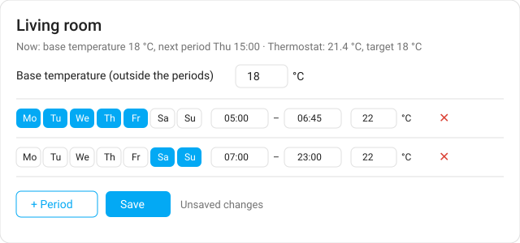

# Heating Schedule Card

A Lovelace card for Home Assistant that edits a **schedule helper** as a list of
heating periods: *days · from · to · temperature*.

Home Assistant's own schedule dialog lets you drag blocks on a weekly grid, but the
temperature of a block is hidden in its "additional data". This card shows every
period as one row instead, with the target temperature next to the times, and saves
straight back into the same schedule helper. It also shows and sets a base
temperature for the time outside the periods and the current state of the thermostat.

The card only edits the plan. Applying it to a thermostat is up to you, for example
with an automation that reacts to the schedule (its state is `on` during a period and
the block data is exposed as attributes).




*Illustration of the card layout.*

## Installation

**HACS:** add this repository as a custom repository (category *Dashboard*), install
"Heating Schedule Card" and reload the browser.

**Manual:** copy `dist/heating-schedule-card.js` to `/config/www/` and add
`/local/heating-schedule-card.js` as a JavaScript module resource.

## Configuration

```yaml
type: custom:heating-schedule-card
name: Living room
schedule: schedule.heating_living_room      # required, a schedule helper
base: input_number.base_temp_living_room    # optional, temperature outside the periods
climate: climate.living_room                # optional, shown in the status line
temperature_attribute: temperature          # optional, key in the block data (default: temperature)
```

- Every row is one period. Tap the days it applies to, set *from*, *to* and the
  temperature, then **Save**. *to* `00:00` means midnight.
- Identical periods on several days are shown as one row.
- Before saving, the card checks for missing days, *to* before *from*, temperatures
  outside 5–30 °C and overlapping periods on the same day.
- Other keys in a block's data are kept when saving.

## Requirements

- A schedule helper created in the UI (storage collection); YAML schedules cannot be
  edited.
- An admin user: saving uses the `schedule/update` WebSocket command.
- A Home Assistant version whose schedule helper supports block data (`data`).

## License

MIT
